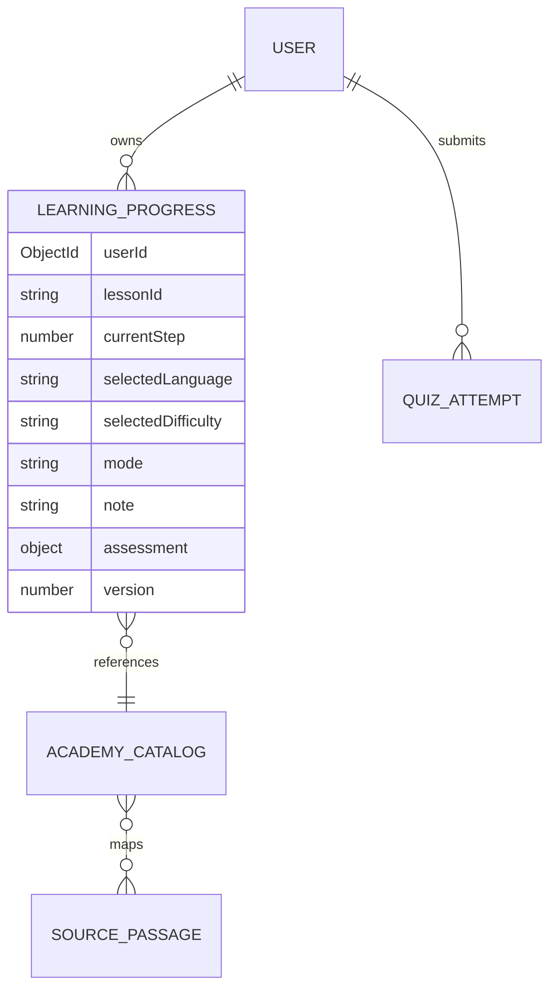
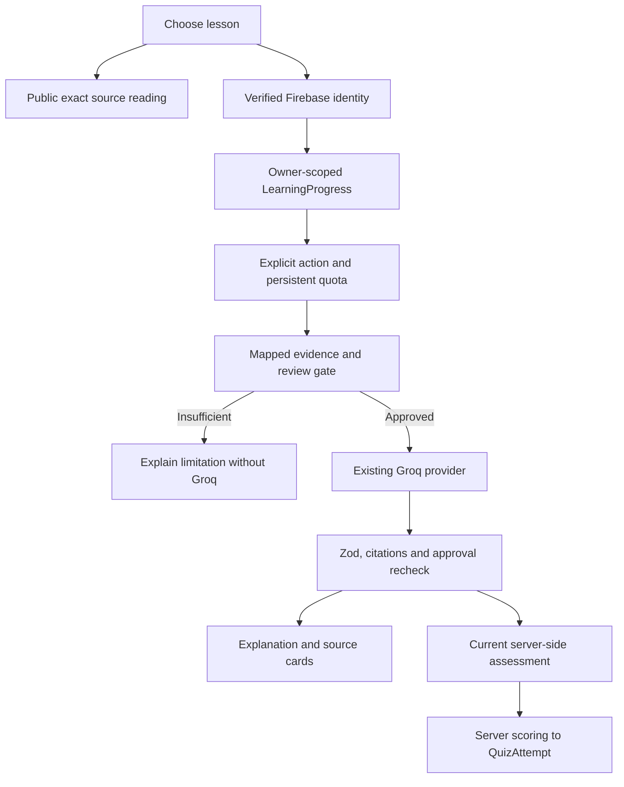

# AI academy architecture

The static-export Next.js/React hash router and independent Express/Mongoose app
remain intact. `learn` opens Academy; `course` and numeric `lesson?id=` retain the
original 15 lessons and their existing progress/import contracts. There are seven
tracks and 36 editorial outlines: 15 mapped passage studies, 21 awaiting mappings
and qualified review. A passage study is not a complete biography or history course.

Frontend Academy.tsx provides dashboard, topic search/categories, continue/recent
learning, outline, source cards, tutor, notes and quizzes. client.ts owns runtime
response checks and isolated guest storage. Existing AnimatedButton, auth context,
backendRequest, i18next and source bundles are reused. No new frontend dependency
or WebGL scene. Learning language is independent of header language: Urdu RTL,
Roman Urdu LTR. Sacred text is loaded exactly from the existing bundles.

Backend academyCatalog selects stable topic IDs; academyService retrieves exact
mapped approved AND license-approved SourcePassages. Every mapped reference must
be covered. Evidence is bounded to eight passages, 4,000 characters each, 12,000
total. The same Groq provider accepts an optional schema and token-usage hook.
Zod validates structures, then validateCitations checks IDs and Quran references.
Approval/hash checks run again before returning a generated result. These checks
do not prove semantic entailment or historical accuracy; expert evaluation remains.

The three-step reading/meaning/reflection engine deliberately avoids constructing
a full historical chronology from isolated verses. Reviewed historical material
can be mapped to an expanded outline after review. Guided/Ask/Story changes style,
not evidence coverage. Q&A includes current lesson/step and up to four truncated
prior turns. Notes are not sent. Academy Q&A stays in tab memory; existing opt-in
persistent AIConversation/AIMessage endpoints are unchanged.

## Persistence and data flow

LearningProgress is reused as the session, unique per owner/lesson. Added fields:
currentStep, selectedLanguage, selectedDifficulty, mode, assessment. Numeric legacy
IDs remain valid; academy IDs use `academy:` and up to 80 characters. Legacy
GET /learning-progress excludes academy rows. QuizAttempt stores objective scores;
the current answer key remains server-side until scoring. Owner transactions
serialize with deletion, and versions protect position/note writes. No new
collection, destructive migration or password store is introduced.

## Cost and deployment

No generation on catalog load or navigation. Non-personal explanations use a
five-minute/100-entry process-local cache and in-flight deduplication, keyed by
outline version, source hashes, language, difficulty, mode and action. Approval is
checked on cache hits. Questions/feedback/quizzes are not shared-cached. Existing
IP and persistent per-user minute/day quotas apply. One provider attempt, SDK
timeout 15s, service bound 18s, frontend 25s. Logs contain action, duration and
SDK token counts when supplied, not prompts or credentials. Metrics are not a
billing estimate, and the cache is not shared across serverless instances.

Deploy backend first, frontend second. Preserve Firebase/API/CORS settings. Reuse
backend-only GROQ_API_KEY, GROQ_MODEL, GROQ_RESPONSE_FORMAT. Official documentation
checked 16 November 2026 lists openai/gpt-oss-120b and openai/gpt-oss-20b as
production models with strict structured outputs. The model stays configurable;
json_schema is preferred when supported. JSON-object fallback still uses Zod.

References: [models](https://console.groq.com/docs/models),
[structured outputs](https://console.groq.com/docs/structured-outputs).

Academy changes have not been pushed or deployed. Prior auth publication approval
was scoped to auth; this feature requires its own explicit publication approval.

## Runtime reviewed-content assignments

SourcePassage now has academyScopes pairs (lessonId, stepId), validated against
known outlines and included in contentHash. Admin proposal/update reuses the
existing ingestion service, which resets review and licensing for changed text,
metadata or scopes. Exact-pair Mongo matching prevents cross-step assignment
leakage. Approved scoped sources can populate existing historical outlines without
rebuilding either application. Public lesson details supply their citation cards;
the frontend merges these with unchanged bundled source reading. New lesson IDs
or new outline structures still require a catalog update. No new collection.

Account's admin-only source editor accepts complete proposal JSON and shows
pending provenance/assignments. Approval remains a separate hash-bound action.
Ordinary users are denied by both the UI and trusted-token backend enforcement.
See ai-academy-content-review.md for the operator workflow.
