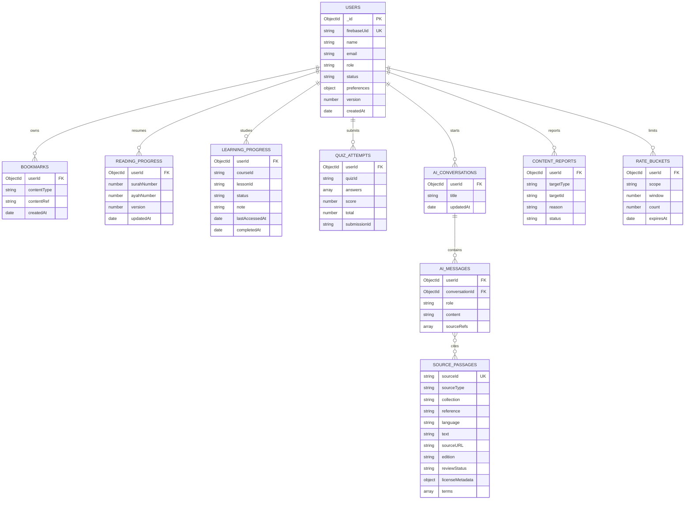

# Backend ERD

ObjectId relations are scoped by the verified owner's internal user ID. Compound unique indexes enforce idempotency; timestamps, versions and deletion status are server-owned. No passwords are stored.

