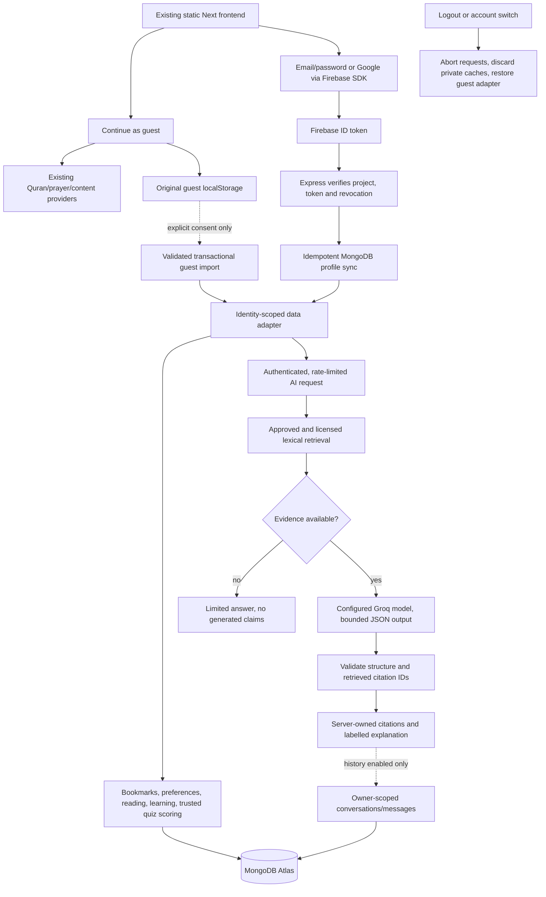

# Backend flow

Auth success and backend sync are separate states. A backend outage preserves the Firebase session and exposes retry. Guests are not redirected away from public features. Deletion requires recent Firebase reauthentication, marks the profile deleting, purges owned data transactionally and deletes Firebase identity; failed deletion remains closed to normal data access and can be retried.
